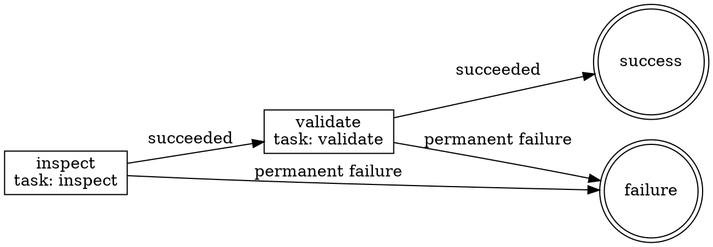

# Graph Rendering

The YAML execution graph remains the source of truth.

## Deliver Source

Return the selected source even when rendering is unavailable:

- Mermaid: a fenced `mermaid` block or `.mmd` file.
- Graphviz: a fenced `dot` block or `.dot` file.

Derive the view from the final YAML. Compare its node IDs, edge directions,
conditions, joins, gates, and terminal states with the YAML before delivery.

## Example

For a graph containing `inspect`, `validate`, and both terminal states, deliver
this Graphviz source before rendering it:



Render it with `dot -Tsvg workflow.dot -o workflow.svg`, then compare all four
node IDs and four edge directions with the YAML.

## Render Mermaid Or Graphviz

Use the first available route:

1. Use the repository's established renderer and settings.
2. Compose with the `diagrams` skill by name when it is available. This skill
   has no dependency on its files.
3. Use an already-installed CLI:

   ```text
   mmdc -i workflow.mmd -o workflow.svg
   mmdc -i workflow.mmd -o workflow.png
   dot -Tsvg workflow.dot -o workflow.svg
   dot -Tpng workflow.dot -o workflow.png
   ```

Ask for approval before acquiring a renderer or another tool. Without
approval, return source only and state that no render was produced.

Inspect a rendered artifact for missing nodes, incorrect edges, clipped labels,
unreadable branches, and ambiguous gate or terminal shapes. Correct the source
and render again when necessary.

## Output

Report the format and source. For a rendered view, also report the renderer,
exact command, output path, exit result, and visual inspection result.
